

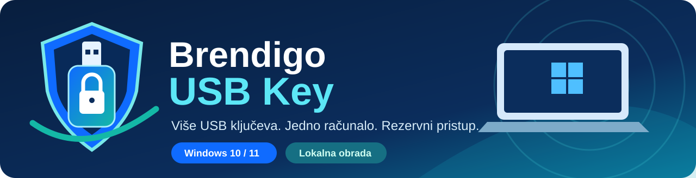

# Brendigo USB Key

**Više USB ključeva. Jedno računalo. Rezervni pristup.**

Windows 10 / 11 · C# / .NET 10 / WPF · Portable testna verzija · Lokalna obrada · MIT

[Preuzmi testnu verziju](https://github.com/bren-wp/USB-Key/releases) · [Kako pripremiti USB](docs/SETUP-USB-HR.md) · [Sigurnosni model](SECURITY.md) · [Prijavi problem](https://github.com/bren-wp/USB-Key/issues)

> [!IMPORTANT]
> **Razvojna alfa 0.2.0.** Trenutačni program registrira i provjerava USB stickove te opcionalno zaključava već otvorenu Windows sesiju. **Umetanje USB sticka još NE otključava zaključani Windows zaslon.** Windows lozinka ili Hello ostaju nepromijenjeni. Ovo nije sigurnosno revidirano produkcijsko izdanje.

## Lokalna USB sigurnost, pod tvojom kontrolom

Brendigo USB Key aplikacija je za Windows koja omogućuje registraciju nekoliko **fizički odvojenih USB stickova**, lokalnu provjeru prisutnosti i opoziv izgubljenih uređaja. Svaki registrirani stick dobiva vlastiti nasumični identifikacijski token. Program može zaključati aktivnu sesiju kada izvadiš posljednji prepoznati stick, ali samo ako sam uključiš tu mogućnost.

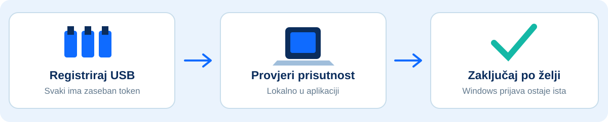

## Funkcionalnosti

| Značajka | Stanje |
| :--- | :--- |
| 🔑 Više USB stickova s različitim tokenima | ✅ Implementirano |
| 🖥️ Brendigo Windows sučelje | ✅ WPF nadzorna ploča i uvodni vodič |
| 🔒 Zaključavanje nakon uklanjanja posljednjeg USB-a | ✅ Opcionalno, dok program radi |
| 🧾 Lokalni sigurnosni dnevnik | ✅ Implementirano |
| 🛡️ Lokalno šifriran registar | ✅ Windows DPAPI CurrentUser |
| 🗝️ Rezervna Windows lozinka / Hello | ✅ Zadržano; nije promijenjeno |
| ☁️ Bez udaljenog servisa i telemetrije | ✅ U trenutačnom kodu |
| 📦 Portable EXE i ZIP za Windows x64 | ✅ GitHub prerelease i Actions artifact |
| 🔓 Otključavanje Windows prijave putem USB-a | ⏳ Nije implementirano |
| 🔐 FIDO2 / hardverski challenge-response | ⏳ Nije implementirano |
| 🖊️ Potpisani Windows instalacijski program | ⏳ Nije implementirano |

## Stvarni prikazi aplikacije

Ove PNG snimke nastale su **iz stvarnih WPF/XAML kontrola** automatskim renderiranjem na Windows CI računalu. Nisu AI koncepti ni zamjenske ilustracije. Prikazuju sadržaj programa bez Windowsove naslovne trake. **Ne dokazuju još pixel-perfect 1:1 podudaranje** s referencama na fizičkim zaslonima, a nisu test interakcija na stvarnim USB uređajima.

### Welcome i nadzorna ploča

| Splash / Welcome | Dashboard |
|:---:|:---:|
| 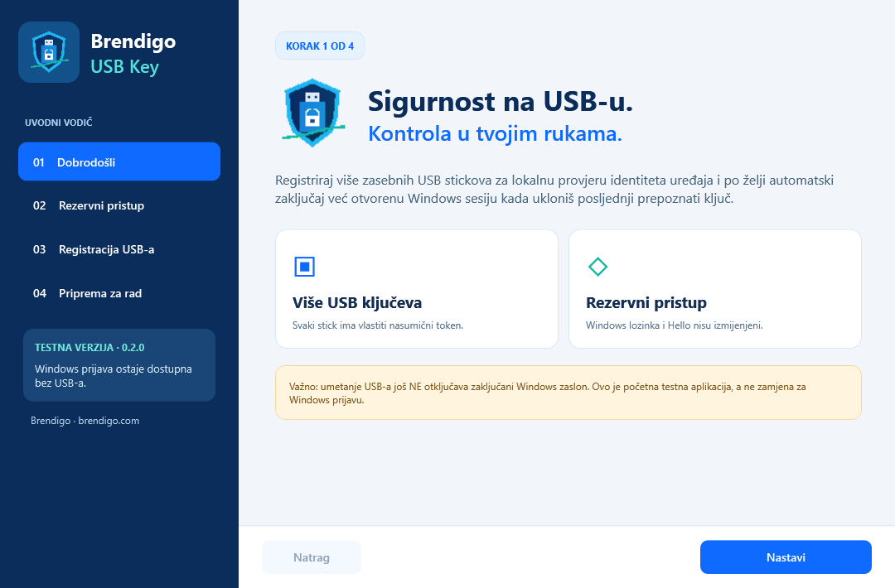 | 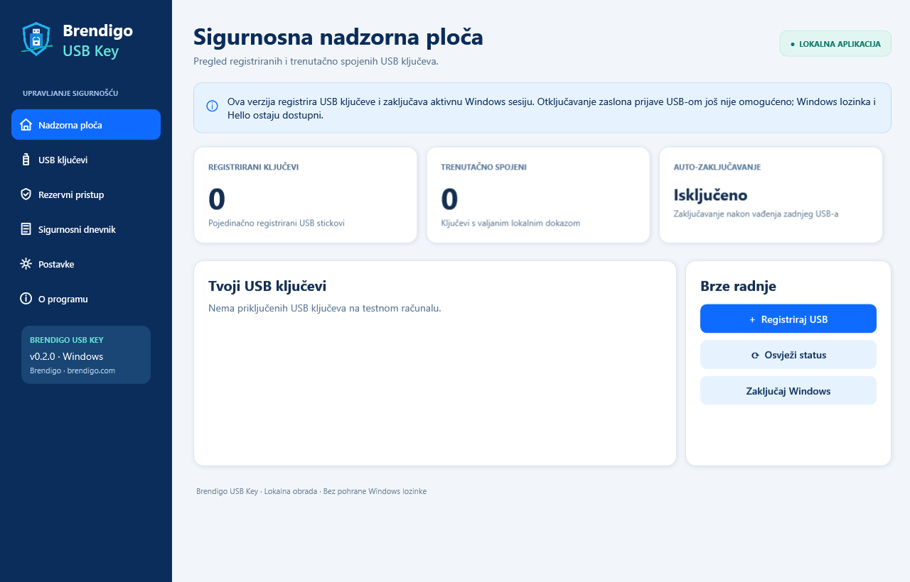 |

### Svaki zaslon — provjeren WPF prikaz

<strong>Otvori galeriju svih 13 zaslona i dijaloga</strong>

| USB Keys | Registracija USB-a |
|:---:|:---:|
| 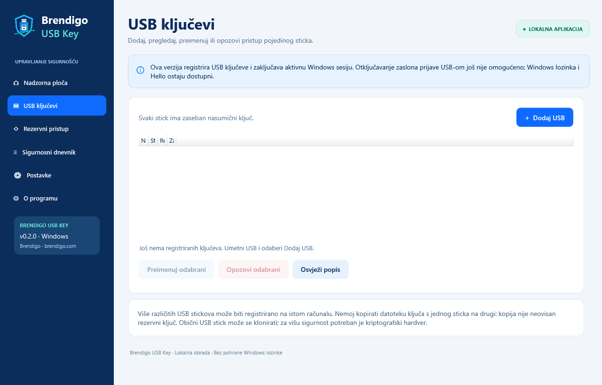 | 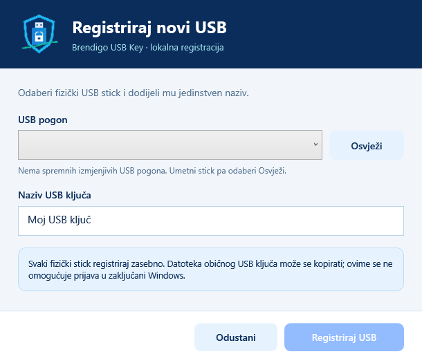 |

| Rezervni pristup | Sigurnosni dnevnik |
|:---:|:---:|
| 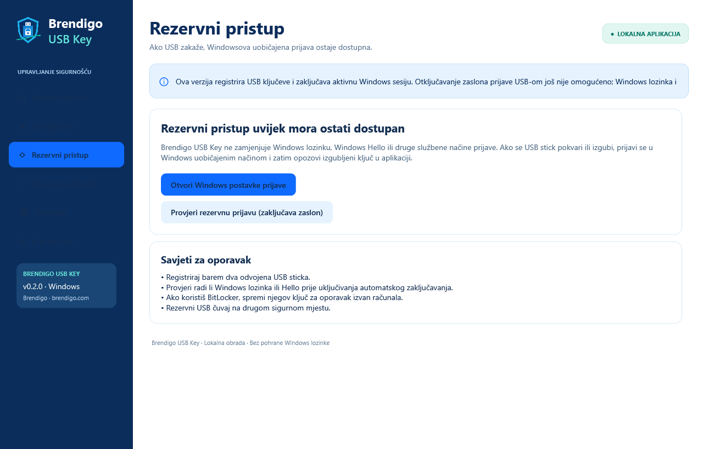 | 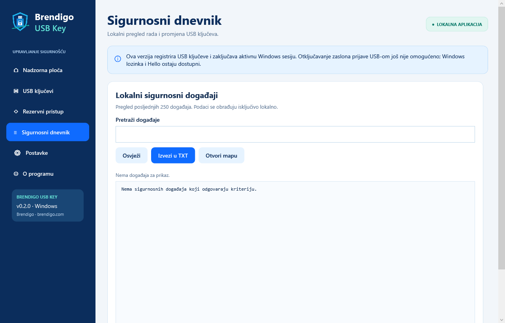 |

| Postavke | O programu |
|:---:|:---:|
| 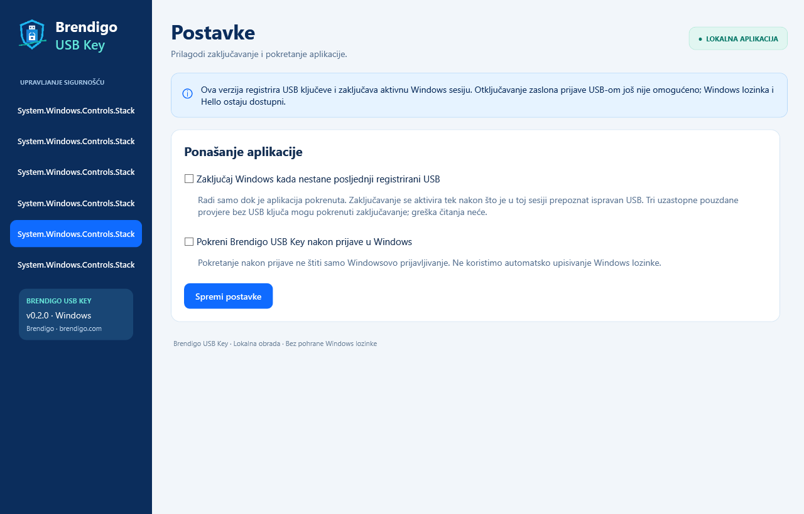 | 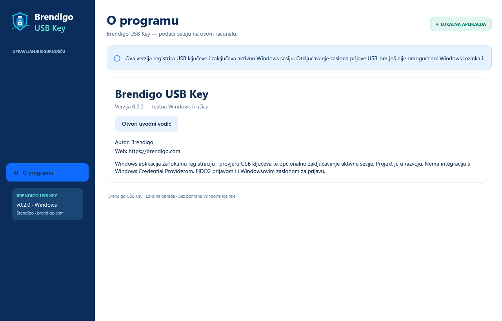 |

| Onboarding: pristup | Onboarding: USB |
|:---:|:---:|
| 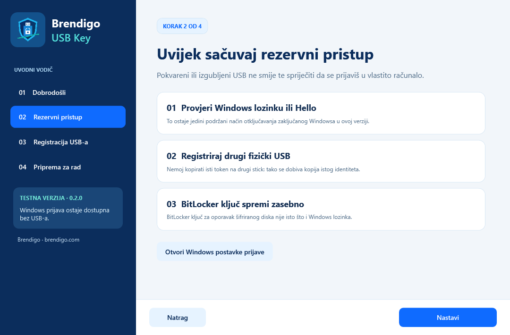 | 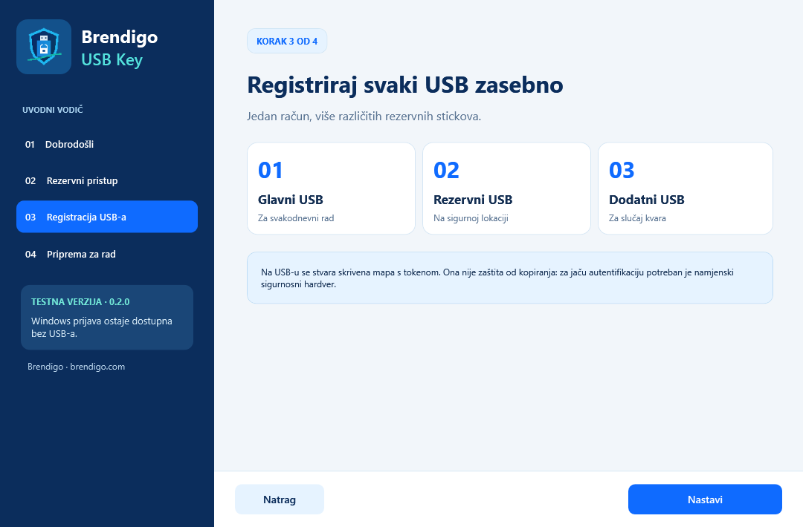 |

| Onboarding: završetak | Preimenovanje USB-a |
|:---:|:---:|
| 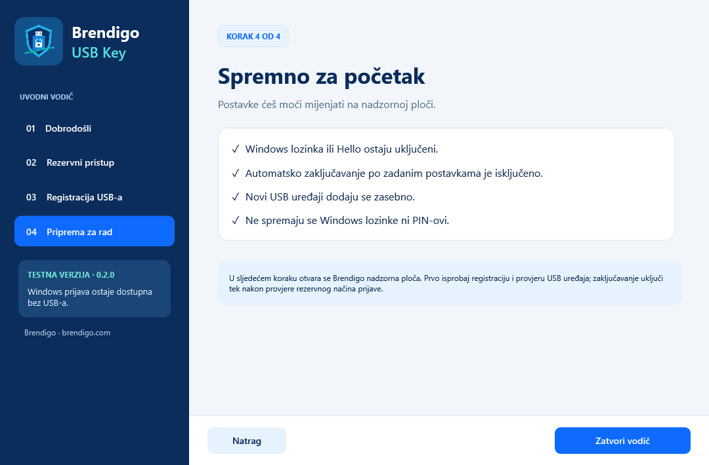 | 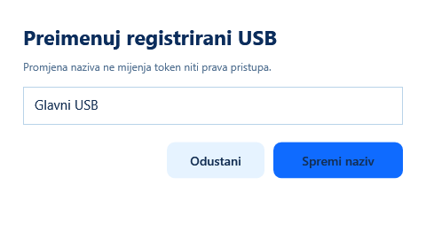 |

| Opoziv USB ključa |
|:---:|
| 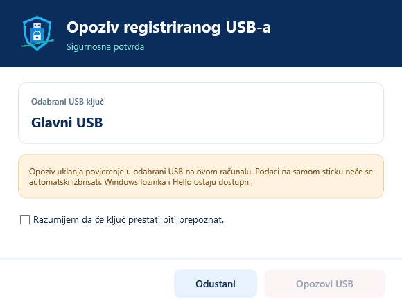 |

Brendigo vizualni sustav koristi tamnoplavu **#0B2D5C**, plavu **#0F6BFF** i tirkiznu **#14B8A6** boju, Segoe UI i lokalne ikone: [SVG logotip](assets/brendigo-usb-key.svg) i [Windows ICO](assets/brendigo-usb-key.ico).

[Metodologija WPF snimanja i ograničenja testa](docs/VISUAL-TESTING.md)

## Preuzimanje i testiranje

1. Otvori [GitHub Releases](https://github.com/bren-wp/USB-Key/releases) i odaberi najnovije **v0.2.0-alpha** testno izdanje.
2. Preuzmi **Brendigo-USB-Key-Portable.exe** (izvršnu datoteku) ili **Brendigo-USB-Key-win-x64-portable.zip** (kompletan paket).
3. Preuzmi **SHA256SUMS.txt** i usporedi SHA-256 kontrolne sume preuzetih datoteka.
4. Za pripremu više USB stickova preuzmi **Brendigo-USB-Key-USB-Setup-Kit.zip**. Komplet sadrži **Portable.exe**, hrvatske i engleske upute te opcionalnu **Install-To-USB.ps1** skriptu za kopiranje programa na provjereni izmjenjivi pogon. Token i dalje moraš registrirati unutar aplikacije. Dostupni su i vodiči [HR](docs/SETUP-USB-HR.md) i [EN](docs/SETUP-USB-EN.md).
5. Za prvo testiranje ostavi **auto-lock isključen** te provjeri da poznaješ Windows lozinku ili Hello PIN.

Aplikacija je self-contained (ne traži zasebnu instalaciju .NET runtimea). **EXE je nepotpisan i namijenjen testiranju**, pa Windows može prikazati sigurnosno upozorenje. Nemoj zaobilaziti poslovne sigurnosne politike. Alternativni [Windows Actions build](https://github.com/bren-wp/USB-Key/actions/workflows/windows-build.yml) sadrži iste vrste testnih datoteka.

**Napomena za USB:** Program se pokreće **na računalu nakon Windows prijave**. USB stick sadrži lokalni token, a ne samostalni Windows prijavni program. Možeš na sticku držati kopiju portable aplikacije, ali umetanje USB-a neće automatski pokrenuti aplikaciju na zaključanom sustavu.

## Rad u Windows obavijesnom području

Kad zatvoriš glavni prozor tipkom **X**, aplikacija ostaje aktivna u **system trayu** i nastavlja lokalni USB nadzor. Dvoklikom na Brendigo ikonu ponovno otvaraš nadzornu ploču. Desnim klikom možeš odabrati **Otvori**, **Zaključaj Windows** ili **Zatvori aplikaciju**. Potpuno zatvaranje prekida nadzor i opcionalno automatsko zaključavanje. Pri Windows autostartu aplikacija preskače uvodni vodič i pokreće se u obavijesnom području.

**Ovo nije privilegirani Windows servis:** korisnik ili drugi proces koji može zatvoriti aplikaciju može prekinuti nadzor.

## Priprema više USB stickova

| USB | Naziv | Preporučena uloga |
| --- | --- | --- |
| 1 | Glavni USB | Svakodnevna upotreba |
| 2 | Rezervni USB | Čuvanje na sigurnom mjestu |
| 3 | Dodatni USB | Zamjena ako se neki drugi pokvari |

1. Prijavi se u Windows i **potvrdi da znaš Windows lozinku ili Hello PIN**.
2. Pokreni Brendigo USB Key i otvori **USB ključevi → Dodaj USB**.
3. Umetni prvi stick, odaberi izmjenjivi pogon i registriraj ga kao **Glavni USB**.
4. Izvadi prvi i zasebno registriraj drugi stick kao **Rezervni USB**.
5. Ponovi za treći stick i provjeri status svih registriranih uređaja.
6. Po želji uključi automatsko zaključavanje tek nakon provjere rezervne Windows prijave.

**Nikad nemoj kopirati datoteku ključa s prvog sticka na drugi.** Time se duplicira identitet, a ne stvara neovisan rezervni ključ. Obični USB token može se kopirati i ne pruža hardversku FIDO2 zaštitu.

[Detaljni USB vodič i oporavak](docs/SETUP-USB-HR.md)

## Sigurnost i oporavak

- Svaki stick dobiva zaseban nasumičan token od **256 bita**.
- Lokalni registar zaštićen je **Windows DPAPI-jem** u kontekstu prijavljenog korisnika.
- Token na običnom USB sticku **nije zaštićen od kopiranja**.
- Nije implementirano spremanje Windows lozinke ni zaobilaženje prijave.
- **Auto-lock radi samo dok je aplikacija pokrenuta** i nakon prethodno prepoznatog USB-a u aktualnoj sesiji.
- Ako USB zakaže, prijavi se u Windows na postojeći način i opozovi neispravan ili izgubljen stick.
- **BitLocker ključ za oporavak diska nije Windows lozinka** i mora se spremiti zasebno.

Pročitaj [SECURITY.md](SECURITY.md) i [plan testiranja](docs/TESTING.md) prije korištenja na stvarnom računalu.

## Izgradnja iz izvornog koda

Za razvoj: Windows 10/11 i .NET 10 SDK.

    git clone https://github.com/bren-wp/USB-Key.git
    cd USB-Key
    dotnet restore src/Brendigo.USBKey/Brendigo.USBKey.csproj
    dotnet build src/Brendigo.USBKey/Brendigo.USBKey.csproj -c Release
    dotnet run --project src/Brendigo.USBKey/Brendigo.USBKey.csproj

Za self-contained izdanje:

    dotnet publish src/Brendigo.USBKey/Brendigo.USBKey.csproj -c Release -r win-x64 --self-contained true -p:PublishSingleFile=true

## Sljedeće razvojne faze

1. Piksel-po-piksel usklađivanje Splash, Onboarding, Dashboard, USB Keys, Recovery, Security Log, Settings i svih dijaloga s vizualnim referencama.
2. Stvarne snimke zaslona, regresijski testovi, visoki DPI i pristupačnost.
3. Dodatne kontrole kvalitete portable paketa, provjera hash-suma i USB dokumentacijskog kompleta.
4. Potpuni sigurnosni i dead-code audit, testiranje na više fizičkih USB stickova.
5. Posebno projektirana hardverska autentifikacija i eventualna Windows prijavna integracija uz zajamčen oporavak.

[Tehnička arhitektura](docs/ARCHITECTURE.md) · [Sigurnosni pregled 0.2](docs/SECURITY-AUDIT-0.2-HR.md) · [Nastavak razvoja — prompt](docs/PROMPT-NASTAVAK-HR.md)

---

**Brendigo USB Key** · Autor **Brendigo** · [brendigo.com](https://brendigo.com)

© 2026 Brendigo · [MIT licenca](LICENSE)

