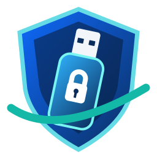

# Brendigo USB Key

**Lokalni Windows program za upravljanje većim brojem USB sigurnosnih ključeva.**

Brendigo USB Key omogućuje registraciju više običnih USB stickova za lokalnu provjeru u aplikaciji, opoziv izgubljenog sticka, sigurnosni dnevnik i opcionalno **zaključavanje aktivne Windows sesije** kada nestane posljednji prepoznati ključ. Windowsova lozinka/Hello ostaju dostupni za oporavak.

> **VAŽNO – razvojna verzija 0.1.0:** Otključavanje samog zaključanog Windows zaslona putem umetnutog USB-a još nije implementirano. Program ne instalira Credential Provider, ne mijenja Windows prijavu i ne čuva Windows lozinku.

## Funkcionalnosti ovog razvojnog izdanja

- Windows WPF sučelje, Brendigo vizualni identitet, hrvatski jezik.
- Registriraj više zasebnih USB stickova na istom korisničkom računu.
- Svaki USB dobiva zaseban kriptografski nasumičan tajni token od 256 bitova.
- Lokalni popis pouzdanih uređaja zaštićen je Windows DPAPI mehanizmom za trenutačnog korisnika.
- Pregled spojenih/nespojenih ključeva, preimenovanje i opoziv.
- Opcionalno zaključavanje Windows sesije nakon uklanjanja posljednjeg registriranog USB-a uz zaštitu od kratkog prekida detekcije.
- Mogućnost automatskog pokretanja nakon Windows prijave.
- Lokalni dnevnik događaja i upute za oporavak.
- Bez cloud servisa, telemetrije ili mrežnog slanja USB tokena.

## Ograničenja i važne sigurnosne napomene

**Obični USB je kopirljiv.** Datoteka .brendigo-usb-key/key.json sadrži tajni token. Onaj tko je kopira može oponašati taj USB ključ u lokalnoj provjeri. Nije riječ o sigurnosnom FIDO2 uređaju.

**Program trenutačno ne otključava Windows.** Za sigurno otključavanje Windows prijave potrebno je zasebno projektirati i provjeriti vlastiti Credential Provider ili koristiti prikladnu Windowsovu autentifikaciju.

**Automatsko zaključavanje radi samo dok je aplikacija pokrenuta** i nakon što je valjan USB prepoznat u tekućoj sesiji. Nije servis otporan na gašenje procesa niti zamjena za Windows zaštitu.

**Oporavak:** zadrži i testiraj Windows lozinku/Hello. Ako koristiš BitLocker, spremi ključ za oporavak na zasebno mjesto.

## Pokretanje

Za razvoj: Windows 10/11 i .NET 10 SDK.

    dotnet restore src/Brendigo.USBKey/Brendigo.USBKey.csproj
    dotnet run --project src/Brendigo.USBKey/Brendigo.USBKey.csproj

Za izdavanje samostalne, nepotpisane portable Windows verzije:

    dotnet publish src/Brendigo.USBKey/Brendigo.USBKey.csproj -c Release -r win-x64 --self-contained true -p:PublishSingleFile=true

GitHub Actions automatski provjerava kompilaciju na Windowsu i prilaže ZIP u **Actions → Windows Build → Artifacts**. Potpisivanje izvršne datoteke nije dio ove verzije.

## Kako dodati više USB stickova

1. Pokreni aplikaciju nakon što se prijaviš u Windows.
2. Umetni prvi USB stick i odaberi Registriraj USB.
3. Odaberi pogon i jedinstveni naziv.
4. Izvadi prvi, umetni drugi fizički USB i ponovi registraciju.
5. Za svaki dodatni USB ponovi postupak. Nemoj kopirati datoteku s prvog sticka na drugi.
6. Provjeri status uređaja i postojeću Windows prijavu prije uključivanja automatskog zaključavanja.

Datoteka na USB-u se ne izvršava automatski. Aplikacija se pokreće na računalu; USB služi kao nositelj lokalnog dokaza.

## Projekt

- Autor / brend: **Brendigo**
- Web: https://brendigo.com
- Platforma: Windows 10 / Windows 11 (x64)
- UI: Windows Presentation Foundation (WPF), .NET 10
- Licenca: MIT (vidi [LICENSE](LICENSE))
- Sigurnosni model: [SECURITY.md](SECURITY.md)
- Arhitektura: [docs/ARCHITECTURE.md](docs/ARCHITECTURE.md)
- Plan testiranja: [docs/TESTING.md](docs/TESTING.md)

Trenutačni status: **razvojni prototip**, ne završena aplikacija za sigurnosno kritičnu prijavu.
