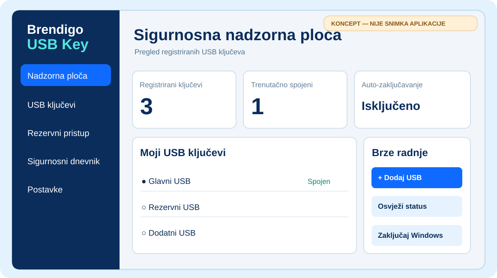

# Brendigo USB Key

**Više USB ključeva. Jedno računalo. Rezervni pristup.**

Windows 10 / 11 · C# / .NET 10 / WPF · Portable testna verzija · Lokalna obrada · MIT

[Preuzmi testnu verziju](https://github.com/bren-wp/USB-Key/actions/workflows/windows-build.yml) · [Kako pripremiti USB](docs/SETUP-USB-HR.md) · [Sigurnosni model](SECURITY.md) · [Prijavi problem](https://github.com/bren-wp/USB-Key/issues)

> [!IMPORTANT]
> **Razvojna alfa 0.1.0.** Trenutačni program registrira i provjerava USB stickove te opcionalno zaključava već otvorenu Windows sesiju. **Umetanje USB sticka još NE otključava zaključani Windows zaslon.** Windows lozinka ili Hello ostaju nepromijenjeni. Ovo nije sigurnosno revidirano produkcijsko izdanje.

## Lokalna USB sigurnost, pod tvojom kontrolom

Brendigo USB Key aplikacija je za Windows koja omogućuje registraciju nekoliko **fizički odvojenih USB stickova**, lokalnu provjeru prisutnosti i opoziv izgubljenih uređaja. Svaki registrirani stick dobiva vlastiti nasumični identifikacijski token. Program može zaključati aktivnu sesiju kada izvadiš posljednji prepoznati stick, ali samo ako sam uključiš tu mogućnost.

## Funkcionalnosti

| Značajka | Stanje |
| :--- | :--- |
| 🔑 Više USB stickova s različitim tokenima | ✅ Implementirano |
| 🖥️ Brendigo Windows sučelje | ✅ Početna WPF verzija |
| 🔒 Zaključavanje nakon uklanjanja posljednjeg USB-a | ✅ Opcionalno, dok program radi |
| 🧾 Lokalni sigurnosni dnevnik | ✅ Implementirano |
| 🛡️ Lokalno šifriran registar | ✅ Windows DPAPI CurrentUser |
| 🗝️ Rezervna Windows lozinka / Hello | ✅ Zadržano; nije promijenjeno |
| ☁️ Bez udaljenog servisa i telemetrije | ✅ U trenutačnom kodu |
| 📦 Portable testni ZIP za Windows x64 | ✅ GitHub Actions artifact |
| 🔓 Otključavanje Windows prijave putem USB-a | ⏳ Nije implementirano |
| 🔐 FIDO2 / hardverski challenge-response | ⏳ Nije implementirano |
| 🖊️ Potpisani Windows instalacijski program | ⏳ Nije implementirano |

## Brendigo sučelje

**Dizajnerski koncept — nije stvarna snimka pokrenute aplikacije.** Stvarne snimke ekrana dodaju se nakon vizualne provjere Windows builda.

Vizualni identitet koristi tamnoplavu **#0B2D5C**, plavu **#0F6BFF** i tirkiznu **#14B8A6** boju, Segoe UI te lokalne ikonice: [SVG logotip](assets/brendigo-usb-key.svg) i [Windows ICO](assets/brendigo-usb-key.ico).

## Preuzimanje i testiranje

1. Otvori [GitHub Actions: Windows Build](https://github.com/bren-wp/USB-Key/actions/workflows/windows-build.yml).
2. Odaberi zadnje uspješno izvršavanje na grani **main**.
3. U odjeljku **Artifacts** preuzmi **Brendigo-USB-Key-win-x64-unsigned**.
4. Raspakiraj arhivu i pokreni izvršnu datoteku.
5. Za prvo testiranje ostavi **automatsko zaključavanje isključeno** i provjeri uobičajenu Windows prijavu.

Aplikacija je *self-contained* i ne traži zasebnu instalaciju .NET runtimea. Izvršna datoteka nije digitalno potpisana. GitHub **Releases** zasad nema objavljeno izdanje: Actions artifact nije isto što i Release.

**Napomena za USB:** Program se pokreće **na računalu nakon Windows prijave**. USB stick sadrži lokalni token, a ne samostalni Windows prijavni program. Možeš na sticku držati kopiju portable aplikacije, ali umetanje USB-a neće automatski pokrenuti aplikaciju na zaključanom sustavu.

## Priprema više USB stickova

| USB | Naziv | Preporučena uloga |
| --- | --- | --- |
| 1 | Glavni USB | Svakodnevna upotreba |
| 2 | Rezervni USB | Čuvanje na sigurnom mjestu |
| 3 | Dodatni USB | Zamjena ako se neki drugi pokvari |

1. Prijavi se u Windows i **potvrdi da znaš Windows lozinku ili Hello PIN**.
2. Pokreni Brendigo USB Key i otvori **USB ključevi → Dodaj USB**.
3. Umetni prvi stick, odaberi izmjenjivi pogon i registriraj ga kao **Glavni USB**.
4. Izvadi prvi i zasebno registriraj drugi stick kao **Rezervni USB**.
5. Ponovi za treći stick i provjeri status svih registriranih uređaja.
6. Po želji uključi automatsko zaključavanje tek nakon provjere rezervne Windows prijave.

**Nikad nemoj kopirati datoteku ključa s prvog sticka na drugi.** Time se duplicira identitet, a ne stvara neovisan rezervni ključ. Obični USB token može se kopirati i ne pruža hardversku FIDO2 zaštitu.

[Detaljni USB vodič i oporavak](docs/SETUP-USB-HR.md)

## Sigurnost i oporavak

- Svaki stick dobiva zaseban nasumičan token od **256 bita**.
- Lokalni registar zaštićen je **Windows DPAPI-jem** u kontekstu prijavljenog korisnika.
- Token na običnom USB sticku **nije zaštićen od kopiranja**.
- Nije implementirano spremanje Windows lozinke ni zaobilaženje prijave.
- **Auto-lock radi samo dok je aplikacija pokrenuta** i nakon prethodno prepoznatog USB-a u aktualnoj sesiji.
- Ako USB zakaže, prijavi se u Windows na postojeći način i opozovi neispravan ili izgubljen stick.
- **BitLocker ključ za oporavak diska nije Windows lozinka** i mora se spremiti zasebno.

Pročitaj [SECURITY.md](SECURITY.md) i [plan testiranja](docs/TESTING.md) prije korištenja na stvarnom računalu.

## Izgradnja iz izvornog koda

Za razvoj: Windows 10/11 i .NET 10 SDK.

    git clone https://github.com/bren-wp/USB-Key.git
    cd USB-Key
    dotnet restore src/Brendigo.USBKey/Brendigo.USBKey.csproj
    dotnet build src/Brendigo.USBKey/Brendigo.USBKey.csproj -c Release
    dotnet run --project src/Brendigo.USBKey/Brendigo.USBKey.csproj

Za self-contained izdanje:

    dotnet publish src/Brendigo.USBKey/Brendigo.USBKey.csproj -c Release -r win-x64 --self-contained true -p:PublishSingleFile=true

## Sljedeće razvojne faze

1. Piksel-po-piksel usklađivanje Splash, Onboarding, Dashboard, USB Keys, Recovery, Security Log, Settings i svih dijaloga s vizualnim referencama.
2. Stvarne snimke zaslona, regresijski testovi, visoki DPI i pristupačnost.
3. Jasno nazvan **Portable.exe**, SHA-256 provjera i dokumentacijski USB komplet.
4. Potpuni sigurnosni i dead-code audit, testiranje na više fizičkih USB stickova.
5. Posebno projektirana hardverska autentifikacija i eventualna Windows prijavna integracija uz zajamčen oporavak.

[Tehnička arhitektura](docs/ARCHITECTURE.md) · [Nastavak razvoja — prompt](docs/PROMPT-NASTAVAK-HR.md)

---

**Brendigo USB Key** · Autor **Brendigo** · [brendigo.com](https://brendigo.com)

© 2026 Brendigo · [MIT licenca](LICENSE)

